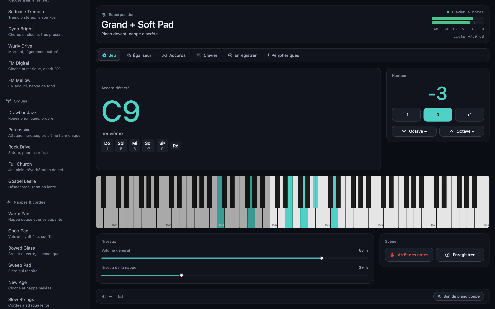
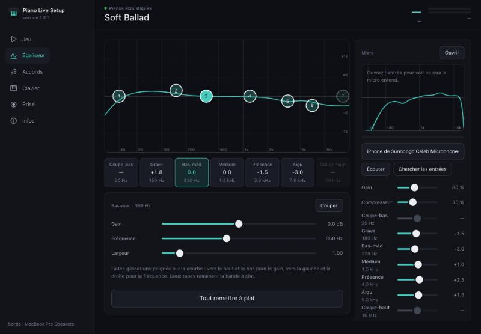
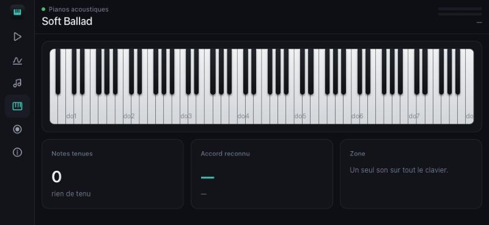

<div align="center">

# Piano Live Setup

**Turn a Mac into the sound engine for any USB MIDI piano.**

51 stage sounds · 7-band EQ over a real-time spectrum analyser · live chord detection
recording to audio, MIDI and sheet music · microphone input · **2.9 ms latency**

[Version française](README.md) · [Architecture](docs/ARCHITECTURE.md) · [Porting](docs/PORTING.md)



</div>

> **The app's interface is in French.** This file is here so the project can be
> understood from anywhere; translating the UI is a welcome contribution —
> see [CONTRIBUTING.md](CONTRIBUTING.md).

---

## Install

> **A Mac makes the sound.** The engine runs there, and the app installs there only. An
> iPad, an iPhone, a Windows PC or a Linux machine **drive** that app from their browser,
> with nothing to install. What it would take to run the engine itself elsewhere is
> spelled out in [docs/PORTING.md](docs/PORTING.md).

```bash
git clone https://github.com/Sunnoogo77/piano_liveSetup.git
cd piano_liveSetup
./install.sh
```

The script checks your Mac, installs what's missing, downloads the sound banks from
their official sources, builds, calibrates all 51 sounds and puts the app in
`/Applications`.

Short on disk? `./install.sh --light` skips the two large sampled pianos (250 MB
instead of 1.5 GB). The affected presets fall back to equivalent sounds — nothing
goes silent.

**Requirements:** macOS 14 or newer, a MIDI piano or keyboard with a USB port, a USB
cable. The installer handles Xcode Command Line Tools, Homebrew, FluidSynth and the
sound banks.

---

## What it does

**One cable.** Plug the piano in over USB. It is recognised whatever the brand —
Yamaha, Korg, Roland, Casio, Nord — and whether you plug it in before or after
launching. Many digital pianos present themselves to the Mac both as a MIDI port and
as a sound card under the same name; when the app sees that, it sends the sound back
into the instrument's own speakers through the same cable. It also silences the
keyboard's internal engine (CC 122, a standard MIDI message) so you don't hear two
pitches when you transpose — and restores it on quit. No setting on the instrument is
ever changed.

**51 calibrated sounds, in ten families.** Six acoustic pianos, six electric, five
organs, six pads — and, for anyone who wants to leave the piano behind: five bowed
strings, four guitars, four accordions and reeds, five mallet instruments. Then seven
layered patches and three keyboard splits. The main piano is a **Yamaha C5 with 16
velocity layers**, and the list folds up family by family. Each variant has its own EQ,
drive, tremolo, compression and velocity curve. All are matched to the same loudness,
measured by offline rendering, with 6 dB of headroom.

**Six screens:** Play, Equaliser, Chords, Keyboard, Record, Devices.

**Chords, spelled properly.** Triads through thirteenths, altered and suspended chords,
slash inversions, and pianists' voicings with the fifth omitted. Notes are named by
their **function in the chord**, not by pitch class: a C9 reads *C E G B♭ D*, an E7
reads *E G♯ B D*. 43 reference chords are checked automatically.

**Recording in four formats:** `audio.wav` (24-bit stereo, effects included),
`performance.mid` (exact timing, replayable on the piano), `partition.musicxml` (two
staves, for MuseScore, Dorico, Finale), `accords.txt` (time-stamped chord chart).

**Remote control from a tablet — the whole app, not a subset.** In the Devices tab, turn
on remote control: the app publishes a page on your local network. Scan the QR code, or
type the address into the tablet's browser, and you get the same screens as on the Mac —
the 51 sounds with search and collapsible families, the 7-band equaliser with its live spectrum
analyser and handles you drag with a finger, chords, keyboard, takes, microphone. The
layout follows the **shape** of the screen, not just its width: a labelled sidebar on an
iPad in landscape, tabs at the bottom on a phone held upright, and — a phone laid flat on
the music desk — a column of icons that hands its sixty points of height back to the curve
and to the eighty-eight keys.

**Nothing to install** — any browser will do. And with **Share → Add to Home Screen** you
get an icon and full screen, without Safari's chrome: it behaves like an app. Levels,
spectrum and held notes arrive over a stream kept open at the app's own frame rate — one
connection for the whole session, no polling.

The Mac keeps making the sound, so you keep the 2.9 ms latency and the 16-velocity-layer
piano. An access key keeps other people on the network out; it is remembered, and the
home-screen icon carries it, so a device pairs once.



*The seven-band equaliser on an iPad in landscape: live spectrum, the curve on top, and
handles you drag with a finger. The chosen band's faders sit under its strip, the
microphone fills the height on the right. The Mac makes the sound; the tablet drives it.*



*The same tool on a phone laid flat: the tabs move to the side as icons, and the
eighty-eight keys take the full width. Nothing scrolls.*

**Microphone input** with its own gain, compressor and independent 7-band EQ. Monitoring
is off by default — an open mic next to the piano's speakers will howl. macOS asks for
microphone permission the first time; if it was refused the app says so and offers to
open the right settings pane, and if the device opens but sends nothing — a locked
iPhone, a muted input — it says that too instead of pretending to work.

---

## Commands

| | |
|---|---|
| `./install.sh` | full install |
| `./install.sh --light` | without the large pianos |
| `./scripts/update.sh` | move to the latest published version |
| `./scripts/update.sh --check` | say whether there is anything new, change nothing |
| `make build` | build only |
| `make test` | hardware-free tests (chords, export formats, portable core) |
| `make test-audio` | everything, including tests that play sound |
| `make calibrate` | re-balance the sounds after editing presets |
| `make preview` | render the interface to PNG without opening the app |
| `make portable` | check the core still builds without Apple frameworks |

---

## Staying up to date

```bash
cd piano_liveSetup && ./scripts/update.sh
```

Fetches, rebuilds, runs the tests, and only replaces the installed app if everything
passes. **Your settings, sounds and recordings are never touched** — they live in
`~/Music/Piano Live Setup`, outside the repository, and a config file written by an older
version stays readable. The app shows its version in the Devices tab and can ask GitHub
whether anything newer exists; it never downloads or installs anything by itself.

Details, rolling back, and publishing a version from a fork:
[docs/UPDATING.md](docs/UPDATING.md). What changed:
[CHANGELOG.md](CHANGELOG.md).

> Note for iPad owners: the page above is a remote control, not the app itself. iPadOS
> only installs apps through the App Store, TestFlight, or Xcode on a connected Mac —
> there is no "clone and install" path, and that is Apple's rule, not a gap in this
> project. [docs/PORTING.md](docs/PORTING.md) explains what a native port would really
> cost.

---

## How it's built

Swift and SwiftUI, no package dependencies, one binary. **FluidSynth** (LGPL) renders
the SF2/SF3 banks, driven from an `AVAudioEngine` render block targeting the chosen
device at 128 frames. Drive, a 7-band biquad EQ, tremolo, compressor and limiter are
written by hand, with no allocation and no locks on the audio thread. The analyser runs
a 2048-point FFT across 128 logarithmic bands.

`Sources/Core/` — the model, DSP, chord detection and recording — **builds without any
Apple framework**, verified on every CI run. See [docs/PORTING.md](docs/PORTING.md) for
what a Linux, Windows, iPad or web port would take.

---

## Working with an AI agent

The repository is written for that. [AGENTS.md](AGENTS.md) holds the code map, the
commands, the rules that must not be broken and the traps already hit.

> Clone https://github.com/Sunnoogo77/piano_liveSetup, read AGENTS.md, install it on
> this Mac following the README, then verify everything with `make test`.

---

## Licences

The code is **MIT**. The sound banks are **not** in this repository: they are downloaded
from their authors at install time, each under its own licence. Two of them require
attribution if you publish a recording. See [CREDITS.md](CREDITS.md) before you release
your music.
