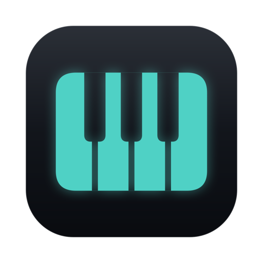
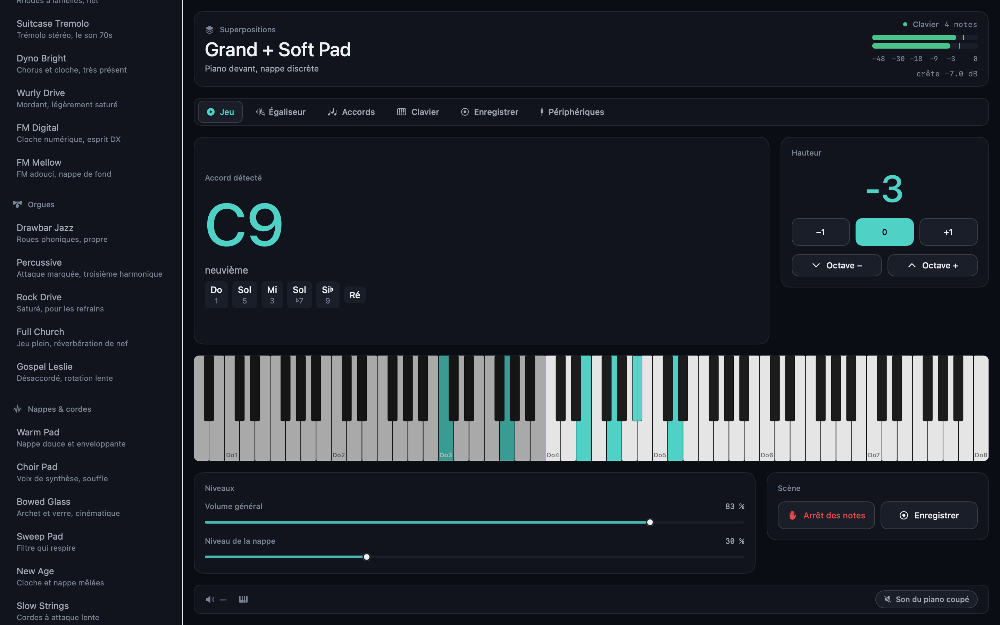
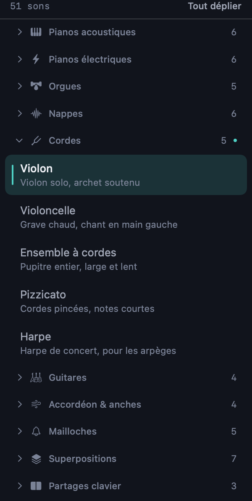
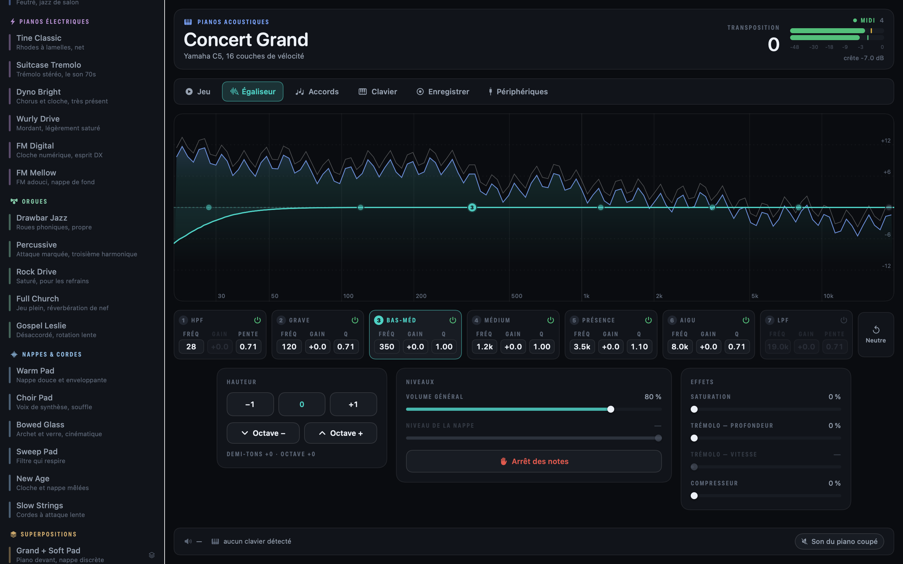
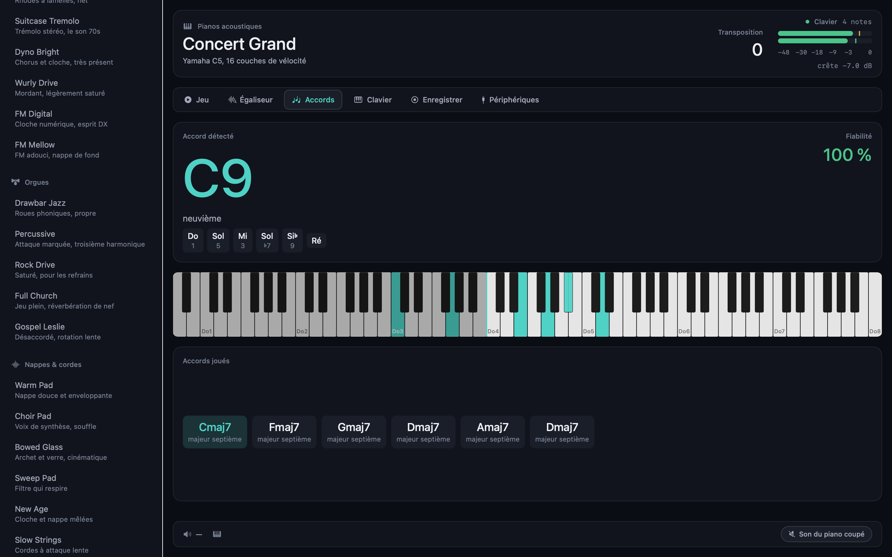
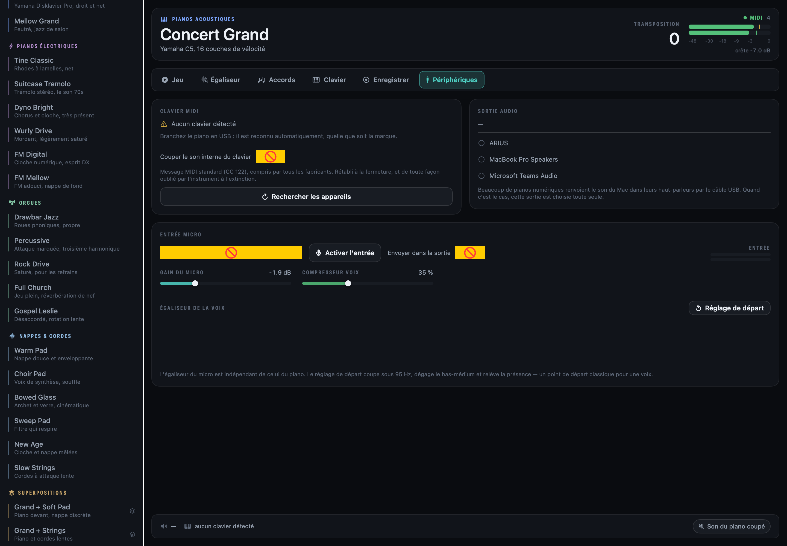
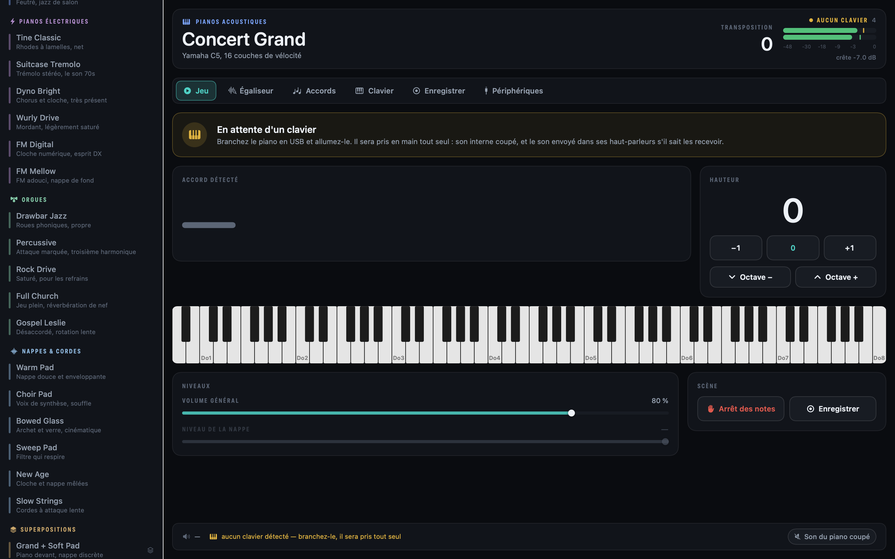
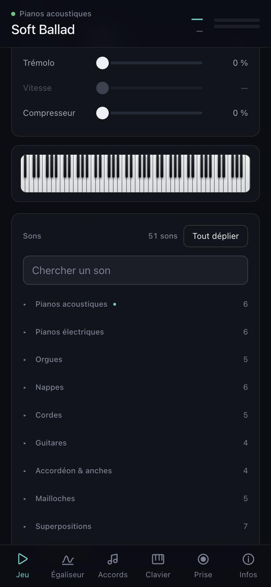
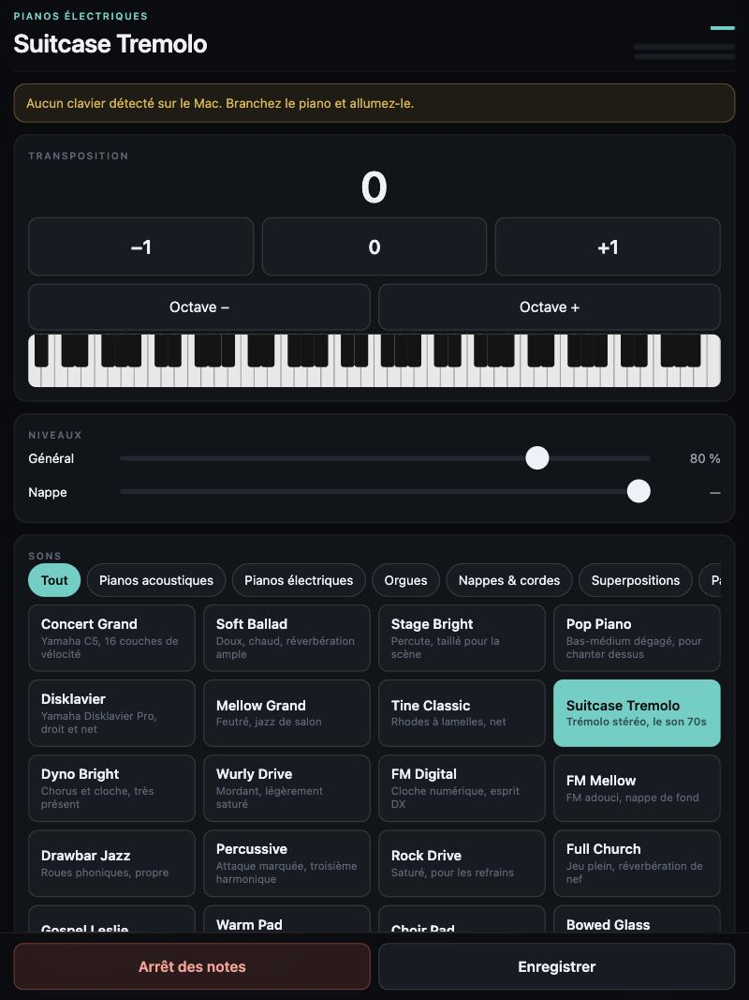

<div align="center">



# Piano Live Setup

**Votre Mac devient l'expandeur de n'importe quel piano numérique branché en USB.**

51 sons de scène · égaliseur 7 bandes sur analyseur de spectre · détection d'accords
enregistrement audio, MIDI et partition · entrée micro analysée · **2,9 ms de latence**

*A macOS live rig for any USB MIDI piano.* **[Read this in English →](README.en.md)**



</div>

---

## Installation

> **Le son est fait par un Mac** : c'est lui qui porte le moteur, et l'application ne
> s'installe que là. Un iPad, un iPhone, un PC Windows ou une machine Linux **pilotent**
> cette application depuis leur navigateur, sans rien installer — voyez
> [Piloter depuis un iPad ou un téléphone](#piloter-depuis-un-ipad-ou-un-téléphone). Ce
> qu'il faudrait pour que le moteur lui-même tourne ailleurs est écrit noir sur blanc
> dans [docs/PORTING.md](docs/PORTING.md).

```bash
git clone https://github.com/Sunnoogo77/piano_liveSetup.git
cd piano_liveSetup
./install.sh
```

C'est tout. Le script vérifie le Mac, installe ce qui manque, télécharge les banques de
sons depuis leurs sources officielles, compile, étalonne les 51 sons et pose
l'application dans `/Applications`.

Peu de place sur le disque ? `./install.sh --light` saute les deux grands pianos
échantillonnés (250 Mo au lieu de 1,5 Go). Les presets concernés basculent
automatiquement sur une équivalence : rien ne devient muet.

| | |
|---|---|
| **Il vous faut** | un Mac sous macOS 14 ou plus récent, un piano ou clavier MIDI avec une prise USB, et un câble USB |
| **L'installateur pose** | les outils Xcode en ligne de commande (si absents), Homebrew (si absent, après accord), FluidSynth, et les banques de sons |
| **Ça prend** | 5 à 10 minutes, selon la connexion |

---

## Ce que ça fait

### Un seul câble, et rien à configurer

Branchez le piano en USB. Il est reconnu **quelle que soit la marque** — Yamaha, Korg,
Roland, Casio, Nord…

Vous pouvez ouvrir l'application piano éteint : elle affiche clairement qu'elle attend
un clavier, et tout le reste reste utilisable. **Dès que vous allumez l'instrument, elle
le prend en main toute seule** : connexion MIDI, son interne coupé, et la sortie audio
bascule sur le piano s'il sait recevoir le son. Rien à cliquer.

Beaucoup de pianos numériques se présentent au Mac à la fois comme port MIDI **et** comme
carte son, sous le même nom. Quand l'application voit ce cas, elle y envoie le son :
vous jouez sur le clavier, vous entendez le Mac **dans les haut-parleurs du piano**, avec
le même câble. Sinon elle prend la sortie par défaut, et vous pouvez en changer à tout
moment.

Elle coupe aussi le son interne du clavier (CC 122, un message MIDI standard) pour que
vous n'entendiez pas deux hauteurs quand vous transposez — et le rétablit en se fermant.
Aucun réglage n'est modifié sur l'instrument.

### 51 sons, en dix familles

Six pianos acoustiques, six électriques, cinq orgues, six nappes — et, pour qui veut
sortir du piano : cinq **cordes** (violon, violoncelle, ensemble, pizzicato, harpe),
quatre **guitares**, quatre **accordéons et anches** (accordéon, bandonéon, harmonica,
harmonium), cinq **mailloches** (vibraphone, marimba, célesta, kalimba, cloches), sept
superpositions et trois partages clavier. Le piano principal est un **Yamaha C5 à 16
couches de vélocité**.

Les variantes ne sont pas des doublons : chacune a son égaliseur, sa saturation, son
trémolo, sa compression et sa courbe de vélocité — c'est comme ça qu'un Nord fabrique ses
sons. Tous sont alignés à la même sonie, mesurée par rendu hors ligne, avec 6 dB de marge
avant saturation ; un son trop percussif pour l'atteindre sans écrêter reste en dessous,
et l'étalonnage le dit.

La liste se replie famille par famille : repliée, c'est un sommaire de dix lignes, et on
choisit un son sans faire défiler cinquante cases.

<div align="center">


*Les dix familles. Celle du son en cours porte un point, pour qu'une famille fermée ne le cache pas.*

</div>

### Six écrans

| | |
|---|---|
| **Jeu** | l'écran de scène : accord joué, hauteur, clavier, niveaux |
| **Égaliseur** | analyseur de spectre temps réel, EQ 7 bandes à points déplaçables, effets |
| **Accords** | l'accord en grand, sa fiabilité, les notes et leurs degrés, l'historique |
| **Clavier** | les 88 touches, les notes tenues, la zone de main gauche |
| **Enregistrer** | la prise en cours et toutes les prises passées |
| **Périphériques** | clavier MIDI, sortie audio, page de commande, entrée micro |

<div align="center">


*L'égaliseur : la courbe se pose sur le spectre, les sept points se tirent à la souris.*


*L'accord en grand, sa fiabilité, les notes avec leur degré, et ce qui vient d'être joué.*


*Les réglages tiennent en colonnes, et l'entrée micro a le même analyseur que le piano.*


*Piano éteint : l'application le dit clairement et reste utilisable. Allumez-le, elle le prend en main toute seule.*

</div>

### Les accords, nommés correctement

Triades, septièmes, sixtes, neuvièmes, onzièmes, treizièmes, altérés, suspendus,
renversements en slash — et les voicings de pianiste avec quinte omise.

Les notes sont nommées **selon leur fonction dans l'accord**, pas selon leur classe de
hauteur : un C9 affiche *Do Mi Sol Si♭ Ré*, un E7 affiche *Mi Sol♯ Si Ré*.
43 accords de référence sont vérifiés automatiquement.

### Enregistrer en quatre formats

Un bouton, et chaque prise écrit :

| Fichier | Ce que c'est |
|---|---|
| `audio.wav` | le son exact qui sort, 24 bits stéréo, effets compris |
| `performance.mid` | MIDI standard, timing exact, **rejouable sur le piano** |
| `partition.musicxml` | la partition, deux portées, pour MuseScore, Dorico, Finale… |
| `accords.txt` | la grille d'accords horodatée |

### Piloter depuis un iPad ou un téléphone



Onglet **Périphériques**, activez **Contrôle à distance**. L'application publie une page
sur votre réseau local. Scannez le QR code affiché, ou tapez l'adresse dans le navigateur
de la tablette.

**C'est l'application entière, pas un bout.** Les mêmes écrans que sur le Mac : les
51 sons avec recherche et familles repliables, l'égaliseur sept bandes avec son analyseur de
spectre et des poignées que l'on déplace au doigt, les accords, le clavier, les prises,
le micro. La mise en page s'adapte : barre latérale sur iPad en paysage, onglets en bas
sur téléphone.

**Rien à installer.** C'est un navigateur — iPad, iPhone, tablette Android, autre
ordinateur. Et avec **Partager → Sur l'écran d'accueil**, vous obtenez une icône et le
plein écran, sans la barre de Safari : à l'usage, c'est une application.

Le Mac continue de faire le son : vous gardez les 2,9 ms de latence et le piano à
16 couches de vélocité. Les niveaux, le spectre et les notes tenues arrivent par un flux
ouvert en permanence, à la cadence de l'application — une seule connexion pour toute la
séance, pas d'interrogation en boucle.

Une clé d'accès protège la page des curieux du même réseau ; elle est conservée, et
l'icône de l'écran d'accueil l'emporte avec elle, donc l'appareil ne se connecte qu'une
fois. Le premier lancement peut faire apparaître une demande du pare-feu macOS :
autorisez les connexions entrantes.

<br clear="right">



*L'égaliseur sept bandes sur un iPad en paysage : le spectre en temps réel, la courbe
par-dessus, et les poignées que l'on déplace au doigt. Le Mac fait le son, la tablette
commande.*

### Un micro, à l'occasion

Entrée micro avec gain, compresseur et un **égaliseur 7 bandes indépendant** de celui du
piano, posé sur **son propre analyseur de spectre** : on voit ce que le micro entend, et
la courbe par-dessus. L'analyseur tourne même quand l'écoute est coupée — on règle
presque toujours une voix sans la renvoyer dans les haut-parleurs. Le renvoi dans la
sortie est coupé par défaut : un micro ouvert près des haut-parleurs siffle, il faut
l'ouvrir exprès.

macOS demande l'autorisation du micro à la première utilisation. Si elle a été refusée,
l'application le dit et propose d'ouvrir le bon volet des réglages ; et si le
périphérique s'ouvre mais n'envoie rien — un iPhone verrouillé, une entrée coupée — elle
le dit aussi au lieu de laisser croire que ça marche. Le micro se pilote aussi depuis la
tablette, y compris le choix de l'entrée.

---

## Les commandes

| | |
|---|---|
| `./install.sh` | installation complète |
| `./install.sh --light` | sans les grands pianos |
| `./scripts/update.sh` | passer à la dernière version |
| `./scripts/update.sh --check` | dire s'il y a du nouveau, sans rien changer |
| `make build` | compiler seulement |
| `make test` | tests sans matériel (accords, formats d'export) |
| `make test-audio` | tous les tests, y compris ceux qui jouent du son |
| `make calibrate` | recalculer l'équilibre des sons après modification |
| `make preview` | rendre l'interface en PNG, sans ouvrir l'app |
| `make portable` | vérifier que le cœur compile sans framework Apple |
| `./scripts/uninstall.sh` | retirer l'application |

Raccourcis dans l'app : `←` `→` transposer · `0` remise à zéro · `[` `]` octave ·
`↑` `↓` son précédent/suivant · `P` arrêt des notes · `R` enregistrer ·
`L` son interne du clavier · `⌘1`…`⌘6` changer d'écran.

---

## Rester à jour

```bash
cd piano_liveSetup && ./scripts/update.sh
```

Le script récupère, reconstruit, lance les tests, et ne remplace l'application que si
tout passe. (Il est arrivé avec la 1.1.0 : si votre copie est plus ancienne, faites
`git pull --ff-only && ./install.sh` une fois, puis le script sera là.) **Vos réglages, vos sons et vos enregistrements ne sont pas touchés** : ils
vivent dans `~/Music/Piano Live Setup`, en dehors du dépôt. Un fichier de configuration
écrit par une version plus ancienne reste lisible — les réglages apparus depuis prennent
leur valeur par défaut, le reste est conservé.

L'application affiche sa version dans l'onglet **Périphériques** et peut demander à
GitHub s'il existe plus récent. Elle ne télécharge et n'installe jamais rien d'elle-même :
elle donne la commande, vous décidez.

Ou demandez-le à votre agent :

> Mets à jour Piano Live Setup : trouve le dépôt cloné sur cette machine, lance
> `./scripts/update.sh`, et montre-moi ce qui a changé.

Détails, retour en arrière et publication d'une version pour un fork :
[docs/UPDATING.md](docs/UPDATING.md). Ce qui change d'une version à l'autre :
[CHANGELOG.md](CHANGELOG.md).

---

## Comment c'est fait

- **Swift + SwiftUI**, sans dépendance de paquet. Un seul binaire.
- **FluidSynth** (LGPL) rend les banques SF2/SF3, appelé depuis le bloc de rendu de
  `AVAudioEngine` ciblé sur le périphérique choisi, à 128 échantillons.
- Le traitement — saturation, EQ 7 bandes en biquads, trémolo, compresseur, limiteur —
  est écrit à la main, sans allocation ni verrou dans le thread audio.
- L'analyseur fait une FFT de 2048 points avec `vDSP`, répartie sur 128 bandes
  logarithmiques.

`Sources/Core/` — modèle, traitement du signal, accords, enregistrement — **compile sans
aucun framework Apple**, vérifié à chaque passage de la CI. L'analyseur a deux
implémentations, celle d'Accelerate et une FFT en Swift pur, qui donnent les mêmes
mesures.

Les détails sont dans [docs/ARCHITECTURE.md](docs/ARCHITECTURE.md). Ce que j'ai appris en
le construisant — les pièges — est dans [AGENTS.md](AGENTS.md).

### Et faire tourner l'application elle-même sur iPad, Windows, Linux ?

C'est autre chose que le contrôle à distance ci-dessus : là, c'est le moteur de son qui
tournerait sur l'appareil, sans Mac. **Rien n'est porté à ce jour**, et je ne vais pas
prétendre le contraire.

Pour l'iPad, la réponse courte : une application iOS s'installe par l'App Store,
TestFlight, ou Xcode sur un Mac relié par un câble. Il n'existe aucun chemin « je clone
le dépôt et j'installe » sur iPadOS — ce n'est pas un manque de ce projet, c'est la règle
d'Apple. Quelqu'un qui n'a **qu'un** iPad utilisera donc la page de commande, qui est
faite pour ça. Le seul chemin vraiment sans Mac serait Swift Playgrounds, qui construit
sur l'iPad lui-même mais ne sait pas lier FluidSynth : il faudrait repartir sur
`AVAudioUnitSampler`. [docs/PORTING.md](docs/PORTING.md) dit exactement ce que ça coûte.

Sur Windows et Linux, cet obstacle n'existe pas, et le cœur
(`Sources/Core/Model.swift`, `DSP.swift`, `Chords.swift`, `Recording.swift`) compile déjà
sans aucun framework Apple — vérifié à chaque passage de la CI. Ce qui reste à écrire est
l'hôte audio et MIDI. La page web, elle, n'a rien de spécifique à macOS : un hôte qui
publie les mêmes routes la réutilise telle quelle.

## Vous travaillez avec un agent IA ?

Le dépôt est écrit pour ça. [AGENTS.md](AGENTS.md) contient la carte du code, les
commandes, les règles à ne pas enfreindre et les pièges déjà rencontrés.

Pour étendre le projet — un son, un effet, un écran, une banque —
[docs/EXTENDING.md](docs/EXTENDING.md) donne la recette de chaque cas.

Donnez simplement ceci à votre agent :

> Clone https://github.com/Sunnoogo77/piano_liveSetup, lis AGENTS.md, installe-le sur ce
> Mac en suivant le README, puis vérifie que tout fonctionne avec `make test`.

Et plus tard, pour une mise à jour :

> Mets à jour Piano Live Setup : trouve le dépôt cloné sur cette machine, lance
> `./scripts/update.sh`, et montre-moi ce qui a changé. Ne touche pas à mes réglages.

---

## Licences

Le code est sous **MIT** — faites-en ce que vous voulez.

Les banques de sons ne sont **pas** dans ce dépôt : elles sont téléchargées chez leurs
auteurs à l'installation, chacune avec sa licence. Deux d'entre elles demandent une
attribution si vous publiez un enregistrement. Tout est détaillé dans
[CREDITS.md](CREDITS.md) — merci de le lire avant de diffuser votre musique.

FluidSynth est sous LGPL et reste un paquet Homebrew séparé.
